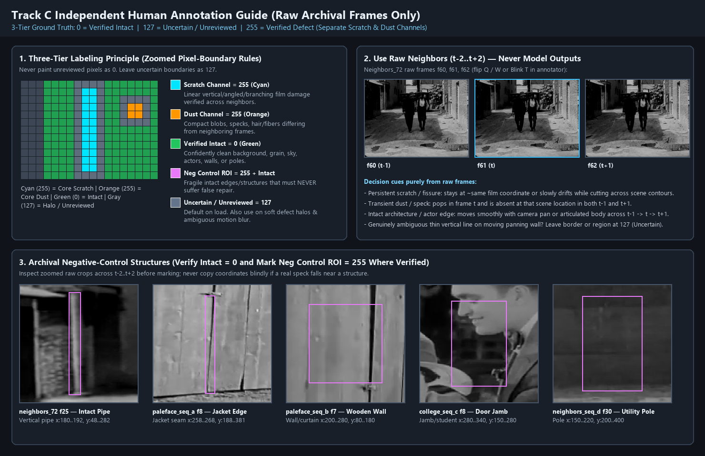

# Track C Human Annotation Guide (Independent Real Archival Ground Truth)



## 1. Strict Independence Rules

- **Source material strictly raw:** Work **only** from original frame `I_t` (`raw_frames/frame_XXXXXX.png`) and raw neighboring frames `I_{t-2}, I_{t-1}, I_t, I_{t+1}, I_{t+2}` (`neighbor_strips/strip_XXXXXX.png`).
- **Never consult model artifacts:** Do **not** view E1/E2 predictions, spatial/temporal detector masks, repair masks, repaired outputs, optical flow fields, temporal frame differences, or synthetic heuristics while labeling.
- **Pilot vs. locked holdout:** All 14 keyframes in `.cache/benchmarks/track_c_pilot_pack/` belong to sequences previously inspected during development (`neighbors_72`, `paleface_seq_a`, `paleface_seq_b`, `college_seq_c`, `neighbors_seq_d`). They are classified strictly as **`dev_diagnostic`** pilot benchmarks—never treat them as a locked cross-film generalization holdout.
- **No synthetic or semi-automatic labels:** Unreviewed pixels start at `127` and are never initialized to `0`. Do not run scripts or thresholds to auto-fill labels.

---

## 2. Launching the Offline Windows Annotator

Run from the repository root (`I:\ai-remaster-pipeline`):

```powershell
.\.venv\Scripts\python.exe scripts\track_c_annotator.py
```

This starts an exclusive local offline server at `http://127.0.0.1:8787/` (or automatically picks the next free local port if `8787` is occupied, verifies HTTP 200 readiness, and opens your browser automatically).

Optional flags:
- `--port 8775` to use a different local port
- `--no-browser` if you prefer opening the printed URL manually

All edits save atomically to single-channel 2D `uint8` PNG masks in `.cache/benchmarks/track_c_pilot_pack/<clip>/templates/` and provenance metadata in `.cache/benchmarks/track_c_pilot_pack/annotation_reviews.json`. **Files in `raw_frames/` and `neighbor_strips/` are read-only and never modified.**

---

## 3. Three-Tier Label Convention & Channels

Every template PNG uses strictly `{0, 127, 255}`:

| Value | Class | Separate Channel Files | Meaning |
| ---: | --- | --- | --- |
| `0` | **Verified Intact** | `*_scratch_gt.png`, `*_dust_gt.png` | Confidently verified defect-free image structure, film grain, sky, actors, walls, pipes, or poles. |
| `127` | **Uncertain / Unreviewed** | All template channels | Default initial state. Also keep `127` on genuinely ambiguous edges, soft defect halos, or heavy motion blur. **Excluded from metrics cleanly with coverage % disclosed.** |
| `255` | **Verified Defect / ROI** | Separate per class below | Confidently verified target class: |

- **Scratch (`*_scratch_gt.png = 255`, Cyan in UI):** Linear vertical, angled, or branching scratches/fissures cutting across scene content or persisting near film coordinates across neighbors. Painting Scratch automatically sets `dust_gt = 0` at those pixels.
- **Dust / Dirt (`*_dust_gt.png = 255`, Orange in UI):** Compact specks, blotches, mold spots, or localized hairs/fibers that appear transiently or do not belong to intact scene structure. Painting Dust automatically sets `scratch_gt = 0` at those pixels.
- **Verified Intact (`0`, Green in UI):** Clean image regions confirmed defect-free across `t-2..t+2`. Never flood-fill the entire frame as `0` without visual inspection.
- **Negative Control ROI (`*_neg_control_gt.png = 255`, Magenta in UI):** Confidently verified intact structures (thin pipes, poles, jacket seams, door jambs, textured wood walls) where any detector repair leakage would be a critical safety failure. Painting this also sets `scratch_gt = 0` and `dust_gt = 0`.

---

## 4. Controls & Practical Decision Cues

### Keyboard & Mouse Shortcuts
- **Left-drag**: Paint active class (`1` Scratch, `2` Dust, `3` Intact, `4` Neg Control ROI, `5`/`E` Uncertain `127`)
- **Wheel**: Zoom smoothly toward cursor (`0.25x` to `24x`; pixel grid appears automatically at `>= 6x`)
- **Right-drag / Middle-drag / Alt+Left-drag**: Pan
- **`B` / `L` / `R`**: Brush / Straight-Line (ideal for straight scratches) / Rectangle fill
- **`[` / `]`**: Decrease / increase brush radius (`1 px` precision up to `32 px`)
- **`Q` / `W`**: Flip backward / forward through raw neighbors (`t-2, t-1, t, t+1, t+2`)
- **`T` / `G`**: Toggle rapid raw blink (`t-1 <-> t <-> t+1`) / Snap immediately back to center raw frame `t`
- **`H` / `U`**: Cycle mask overlay opacity (`0% -> 50% -> 80%`) / Toggle `127` unreviewed checkerboard highlight
- **`Ctrl+Z` / `Ctrl+Y`**: Multi-step Undo / Redo
- **`Ctrl+S`**: Save current frame masks and provenance metadata to disk (resume later at any time)

### Practical Archival Annotation Tips
1. **Separate scratch vs. dust vs. intact edges:** Flip `Q`/`W` or press `T` while watching the synchronized 5-frame raw strip dock. Intact vertical edges (pipes, door frames, poles, striped fabric) move coherently with the scene or camera pan. Transient dust pops at one frame (`t`) and disappears cleanly in `t-1` and `t+1`. Persistent film scratches maintain similar film-coordinate traces or slice independently across moving foreground/background contours.
2. **Buffer uncertain halos as `127`:** Label the unmistakable defect core as `255`, keep a 1–2 px blurry/aliased halo as `127` if uncertain, and mark confidently clean surrounding pixels as `0`.
3. **Key Pilot Focus Areas (Screen Full Frames Too):**
   - `neighbors_72` (`0, 12, 23, 25, 36, 48, 61, 62, 71`): Screen full frames `61` and `62` thoroughly for branching/persistent scratches; verify intact vertical pipe around `x:180..192, y:48..282` in frame `25`.
   - `paleface_seq_a` frame `8`: Inspect moving actor jacket seam around `x:258..268, y:188..381` alongside full frame.
   - `paleface_seq_b` frame `7`: Inspect intact wooden wall/curtain around `x:200..280, y:80..180` alongside full frame.
   - `college_seq_c` frame `8`: Inspect door jamb/student area around `x:280..340, y:150..280` alongside full frame.
   - `neighbors_seq_d` frames `2` & `30`: Inspect intact utility pole around `x:150..220, y:200..400` alongside full frame.

---

## 5. Two-Pass Quality Verification & Conflict Check

Recommended workflow before running Track C model comparisons:
1. **First pass:** Annotate all visible defects, intact regions, and critical negative controls; record annotator initials and set status to `first_pass_complete`.
2. **Second pass:** Re-open each frame (ideally by a second reviewer or in a fresh pass checking `U` Unreviewed highlights and blinking `T`), resolve any channel conflicts (`scratch==255 & dust==255` or `neg_control==255 & defect==255`), record `2nd-Pass Reviewer` initials, and set status to `second_pass_verified`.

Run the validation & status report generator at any time (non-destructive; never modifies labels):

```powershell
.\.venv\Scripts\python.exe scripts\prepare_track_c_annotation_pack.py --verify-human-labels --status-report
```

This writes per-frame coverage, pixel counts, conflicts, and review provenance to:
- `docs/benchmarks/track_c_pilot_status_report.md`
- `docs/benchmarks/track_c_pilot_status_report.json`

---

## 6. Post-Annotation Model Comparison (Strictly After Human GT Exists)

Once human annotations are saved (and ideally `second_pass_verified`), evaluate candidate detector variants strictly over human-verified regions (`127` excluded, per-frame coverage disclosed):

```powershell
.\.venv\Scripts\python.exe scripts\evaluate_track_c_human_gt.py
```

If you have an archived pre-safety-fix E2 mask directory from prior experiments, optionally pass `--previous-e2-dir <dir>` to compare Previous E2 side-by-side against Spatial-only, Temporal-only, Corrected E2, and actual Conservative Repair execution (`A2` & `E2`).
