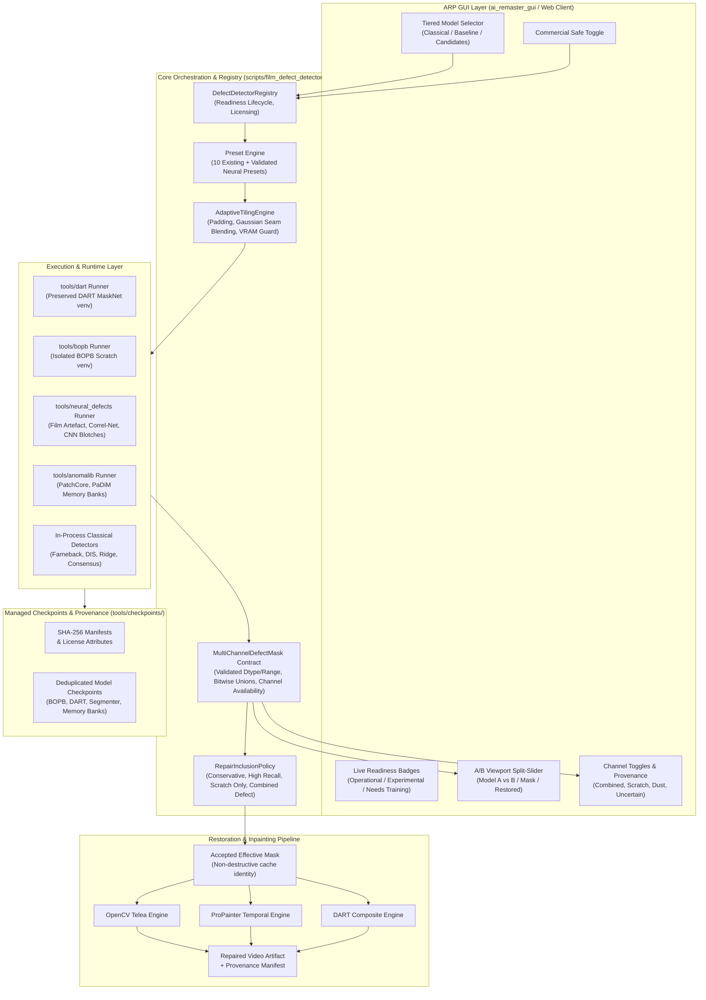
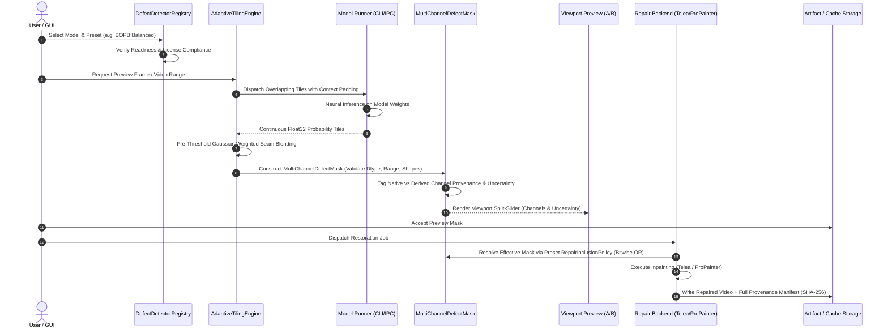

# ARP — Next-Generation Neural Dust & Scratch Detection Design Document

## 1. Problem Statement

Historical motion picture film is subject to physical deterioration including vertical tramline scratches, transient dust, dirt blotches, and emulsion abrasions. ARP currently possesses a robust functional baseline: five classical detectors (Farneback 3F, DIS Flow, Temporal Ridge, Consensus 5F, ARP Legacy), operational DART neural inference, ten benchmark-validated presets, mask-to-repair integration (Telea, ProPainter), Commercial Safe filtering, and artifact provenance.

However, to evolve into a next-generation defect restoration system, ARP must overcome specific structural limitations:
1. **Expansion Beyond Single Neural Baseline**: DART is currently the sole operational neural detector. Diverse modern paradigms—BOPB (Microsoft Bringing Old Photos Back to Life scratch detection), Correl-Net (temporal motion correlation), Film Artefact Segmenter (Ivanova et al. multi-class damage segmentation), CNN Blotches & Scratches (Yous/Serir encoder-decoder), and feature memory-bank anomaly detectors (PatchCore, PaDiM)—must be evaluated, reproduced, and integrated into ARP's architecture.
2. **Authentic Research & Training Discipline**: Where official checkpoints exist (BOPB), they must be verified and integrated faithfully. Where pretrained weights are unpublished (Correl-Net, Film Artefact Segmenter, CNN Blotches & Scratches), authentic clean-room research reproductions and reproducible training workflows must be constructed using verified datasets (FilmDamageSimulator, AbsoluteDegradation). Unrelated networks, fabricated weights, pseudo-labeled ground truth, or cosmetic GUI placeholders are strictly prohibited.
3. **Four-Tier Model Readiness Governance**: To maintain absolute transparency and prevent runtime failures, all candidate models must be explicitly governed across four distinct states: `PRETRAINED_OPERATIONAL`, `TRAINED_EXPERIMENTAL`, `TRAINING_REQUIRED`, and `BLOCKED`. Only models with verified, functional inference backends and valid checkpoints may be selected for processing in the active pipeline.
4. **Resolution of DART's False-Dust Flaw via Explicit Uncertainty**: The existing DART post-processing automatically routes unclassified defect components into the `Dust` channel, causing severe false positives on human faces, straight architectural edges, and fast-moving subjects. This must be replaced with explicit uncertainty handling that preserves native probabilities, isolates ambiguous regions into an `Uncertain` channel, and allows preset-governed repair inclusion policies without regressing DART's validated peak F1 performance (0.9032).
5. **Full-Resolution Defect Fidelity**: Fixed-resolution networks (e.g. 256px BOPB, 512px DART) risk obliterating 1–3px hairline scratches when fed naively downscaled 1080p/2K/4K film scans. An adaptive, model-specific tiling engine with context padding, pre-threshold continuous probability blending, and temporal grid locking must be benchmarked and deployed with strict VRAM safety guards.
6. **Non-Destructive Invariance & Permission Safety**: All existing user projects, saved presets, accepted masks, rendered videos, research datasets, benchmark reports, dirty working tree modifications, and non-elevated Windows ACL configurations must be preserved without destructive Git operations or administrative privilege escalations.
7. **End-to-End Pipeline & Provenance Closure**: Every operational detector must participate in the complete execution chain: GUI selection → preset resolution → real neural inference → multi-channel mask generation → preview → user adoption → exact mask consumption by OpenCV Telea or ProPainter → repaired video artifact, accompanied by persistent SHA-256 provenance and Commercial Safe compliance metadata.
8. **Empirical Benchmarking Rigor**: Presets and claims of superiority must be supported strictly by comparative measurements across identical evaluation frames, maintaining strict separation between synthetic ground truth, manual annotations, and real historical footage.

---

## 2. Requirements

### 2.1 Functional Requirements

* **FR-1: Mandatory Model Roster & Readiness Lifecycle**:
  * Include all seven named neural approaches: DART (existing baseline), BOPB Scratch Detection, Correl-Net, Film Artefact Segmenter, CNN Blotches & Scratches, PatchCore (Film-Adapted), and PaDiM (Film-Adapted), alongside five classical baselines.
  * Every model in `DefectDetectorRegistry` must register an explicit readiness state: `PRETRAINED_OPERATIONAL`, `TRAINED_EXPERIMENTAL`, `TRAINING_REQUIRED`, or `BLOCKED`.
  * The active pipeline selector must strictly allow execution only for models in `PRETRAINED_OPERATIONAL` or validated `TRAINED_EXPERIMENTAL` states. Models requiring setup or training must be surfaced with actionable instructions.

* **FR-2: Real Neural Model Inference & Checkpoint Lifecycle**:
  * Integrate official BOPB scratch detection using verified upstream weights and architecture (`Global/detection.py`).
  * Preserve existing DART neural inference and its ARP-managed installation under `tools/dart`.
  * For models lacking trained checkpoints (Correl-Net, Film Artefact Segmenter, CNN Blotches & Scratches, PatchCore, PaDiM), implement faithful architectural reproductions and actual reproducible training where feasible.
  * **Strict Completion Rule**: Training scripts alone do *not* qualify as completed model integration. Completed integration requires verified checkpoint loading, real inference, actual mask artifacts, and operational GUI-to-backend dispatch.
  * Unavailable or untrained models remain visible in a Model Manager interface with honest status, but are never presented as executable in the active pipeline.

* **FR-3: Unified Multi-Channel Defect Contract & Safe Uncertainty Handling**:
  * Standardize all defect outputs on `MultiChannelDefectMask` exposing:
    1. Raw continuous floating-point probability map.
    2. Discrete binary channel masks: `combined`, `scratch`, `dust`, `uncertain`.
    3. Channel provenance metadata marking each channel as `native` or `derived` (with algorithm and parameters).
  * Eliminate the automatic assignment of unclassified defect components into Dust. Ambiguous components meeting calibrated criteria are routed to the `uncertain` channel.
  * Enforce preset-governed `RepairInclusionPolicy` (`conservative` [scratch + dust], `high_recall` [scratch + dust + uncertain], `scratch_only`, or `combined_defect`).

* **FR-4: Adaptive Tiling & High-Resolution Defect Fidelity**:
  * Implement `AdaptiveTilingEngine` supporting 1080p, 2K, and 4K film scans.
  * Tailor tile dimensions, context padding, and overlap to model-specific receptive fields (e.g. 256px for BOPB, 512px for DART/Segmentation).
  * Blend overlapping continuous probability maps using distance/Gaussian weighting *prior* to thresholding.
  * Maintain spatially locked tile grids across frame windows for temporal models with shot boundary detection.

* **FR-5: Intelligent Benchmark-Backed Presets**:
  * Preserve all 10 existing ARP presets and their exact identifiers.
  * Create new empirical, model-specific presets (Fast Preview, Balanced, High Precision, High Recall, Archival Preservation) backed strictly by measured benchmark data.
  * Presets must bind model identity, checkpoint hash, tiling configuration, thresholds, uncertainty policy, and recommended repair backend.

* **FR-6: GUI Workspace Integration**:
  * Organize the detector dropdown into tiered optgroups (Classical, Neural Baseline, Neural Candidates) with live readiness status badges.
  * Provide an interactive A/B viewport split-slider (Model A vs Model B, or Raw vs Mask vs Restored).
  * Implement dynamic `Commercial Safe` toggle that filters out research-only models (e.g. BOPB) with clear license attribution.
  * Provide interactive preview of all individual channels (`scratch`, `dust`, `combined`, `uncertain`).

* **FR-7: End-to-End Restoration Pipeline Integration**:
  * The exact accepted effective mask must be consumed by the selected repair backend (OpenCV Telea, ProPainter, or DART composite).
  * Preserve the distinction between detector outputs, preview masks, accepted masks, and effective repair masks.
  * Ensure no repair backend silently regenerates or substitutes unrelated legacy masks.
  * Preserve non-destructive mask adoption and independent artifact identities.

* **FR-8: Comprehensive Provenance & Audit Trail**:
  * Persist detector architecture, implementation version, model checkpoint SHA-256, training dataset, source, and license classification.
  * Record the selected preset, all resolved inference parameters, native/derived mask channel semantics, uncertainty policy, and repair backend.
  * Preserve full processing provenance in project state, artifact manifests, and exported reports.
  * Commercial Safe eligibility must be evaluated from actual artifact history, not merely the currently selected GUI mode.

* **FR-9: Model Training & Empirical Acceptance**:
  * Reproducible training workflows with fixed seeds, documented configurations, source-film-level train/validation/test separation, checkpoint hashes, and training logs.
  * Evaluate all operational models against existing DART and classical baselines.
  * Report per-class Precision, Recall, F1, IoU, false-positive rates (clean regions, faces, architecture, motion), temporal consistency, processing latency, and VRAM.
  * Strict separation between synthetic ground truth, authentic manual ground truth, and pseudo-labels.
  * No claims of superiority or optimal presets without independent benchmark evidence. Models unable to complete training must be reported as `TRAINING_REQUIRED` or `BLOCKED`.

* **FR-10: Real End-to-End Acceptance Tests**:
  * Launch ARP under a non-elevated Windows user account.
  * Execute real neural inference from each operational model's managed environment.
  * Verify selected model and preset parameters reach the correct backend.
  * Verify masks appear correctly in GUI previews and preview adjustments never overwrite accepted masks.
  * Verify the exact accepted effective mask is consumed by Telea, ProPainter, or other repair backends.
  * Produce real repaired video artifacts with validated provenance and run the full existing ARP regression test suite.

### 2.2 Non-Functional Requirements

* **NFR-1: Resource & Memory Bounding**:
  * Dynamic VRAM monitoring with auto-downthrottling or CPU fallback to prevent CUDA Out-Of-Memory errors during long video runs. Any fallback must be explicit, reported, and traceable (never silently altering resolution or model).
  * Centralized checkpoint caching under `tools/checkpoints/` to eliminate duplicate multi-gigabyte files.
* **NFR-2: Performance, Latency & Processing Integrity**:
  * Distinguish interactive preview latency from full-quality 1080p/2K/4K batch processing (no blanket sub-second requirement for high-res scans).
  * Define per-model performance targets derived from empirical benchmark measurements.
  * Optimize batching, tiling, checkpoint reuse, and GPU utilization without compromising detection fidelity.
  * Never silently substitute another model, resolution, device, or quality profile to satisfy a latency target.
* **NFR-3: Scientific Reproducibility**:
  * Strict separation between synthetic ground truth, manual annotations, pseudo-labels, and untouched test footage.
* **NFR-4: Backward Compatibility & Invariance**:
  * 100% preservation of existing accepted masks, saved user projects, and legacy 2-channel mask interfaces.

### 2.3 Constraints

* **C-1: Windows Non-Elevated Execution**:
  * Must run reliably under standard, non-elevated Windows user accounts without altering ACLs or requiring Administrator privileges.
* **C-2: Working Tree & Git Safety**:
  * Existing uncommitted changes must be preserved and carefully reconciled, not blindly overwritten.
  * Necessary edits to already-modified files (e.g. `scripts/film_defect_detectors.py`) are permitted under a single integration owner after inspecting existing changes.
  * Strictly no `git reset`, `git clean`, broad stash, auto-commit, merge, or push.
* **C-3: Single Integration Owner**:
  * One agent manages writes to shared core files to prevent concurrent race conditions.

---

## 3. Approach

### 3.1 Selected Approach: Hybrid Isolated-Core Architecture with Model-Specific Tiling & Native-Derived Multi-Channel Provenance

1. **Hybrid Execution & Runtime Topology**:
   * **Consolidated PyTorch Environment (`tools/neural_defects`)**: Hosts modern, compatible PyTorch architectures (Film Artefact Segmenter, Correl-Net, CNN Blotches & Scratches) to eliminate multi-gigabyte virtualenv duplication.
   * **Isolated Framework Environments**: Dedicated standalone virtualenvs for packages with mutually incompatible dependency trees:
     - `tools/dart`: Preserves the existing validated DART MaskNet environment.
     - `tools/bopb`: Isolated environment for Microsoft Bringing Old Photos Back to Life scratch detection (`Global/detection.py`).
     - `tools/anomalib`: Isolated environment for PatchCore and PaDiM anomaly localization models.
   * **Stateless Pinned CLI/IPC Runners**: Communication between ARP's core Python process and the model subenvironments occurs via deterministic CLI runners exchanging standardized JSON manifests, floating-point probability tensors, and PNG/TIFF mask artifacts.

2. **Centralized Model Checkpoint & Provenance Store (`tools/checkpoints/`)**:
   * Deduplicated storage for all model weights, preventing multi-gigabyte bloat in Git.
   * Checkpoint manifests record: model identity, upstream URL/source, SHA-256 hash, code/weight licenses, training dataset provenance, and parameter schema.
   * Automated verification on startup: hashes are validated prior to execution, preventing corrupted or tampered weight loading.

3. **Multi-Channel Defect Contract & Safe Uncertainty Handling (`MultiChannelDefectMask`)**:
   * Replaces DART's legacy binary assumption with a 4-channel contract:
     - `combined`: Native continuous defect probability / anomaly score map.
     - `scratch`: High-confidence linear/tramline defect mask.
     - `dust`: High-confidence transient blotch/dust mask.
     - `uncertain`: Ambiguous defect regions failing confident geometric/temporal classification.
   * **Native vs. Derived Channel Provenance**: Every channel explicitly tracks its derivation source (e.g. `native_head` vs. `morphological_derivation` with recorded eccentricity/verticality parameters).
   * **Preset-Governed Repair Policy**: Controls which channels form the effective repair mask (`conservative`: Scratch + Dust; `high_recall`: Scratch + Dust + Uncertain; `scratch_only`: Scratch only; `combined_defect`: Full combined defect mask).

4. **Adaptive Tiling Engine (`AdaptiveTilingEngine`)**:
   * Supports native 1080p, 2K, and 4K scans by dividing frames into model-appropriate overlapping patches (e.g. 256px for BOPB, 512px for DART/Segmentation).
   * Context padding and distance/Gaussian weight blending applied to continuous probability maps *before* discrete thresholding, preventing seam artifacts.
   * Spatially locked tile coordinates across temporal sequences for motion-aware models.
   * Dynamic VRAM guard with explicit, non-silent reporting for batch throttling or CPU fallback.

5. **Tiered GUI Workspace & Restoration Integration**:
   * Tiered optgroup model selector: `Classical Baselines`, `Neural Baseline (DART)`, `Neural Candidates`.
   * Live readiness badges (`PRETRAINED_OPERATIONAL`, `TRAINED_EXPERIMENTAL`, `TRAINING_REQUIRED`, `BLOCKED`).
   * Interactive A/B split-slider in viewport for side-by-side inspection.
   * Dynamic Commercial Safe toggle gating research-only models with clear license notices.
   * Traceable mask handoff to OpenCV Telea and ProPainter without overwriting accepted masks.

### 3.2 Decision Matrix

| Evaluation Dimension | Weight | Approach 1: Hybrid Isolated-Core (Selected) | Approach 2: Persistent Local Daemons | Approach 3: Monolithic In-Process |
| :--- | :---: | :---: | :---: | :---: |
| **Dependency & OS Isolation** | 25% | **9.5 / 10** | 8.0 / 10 | 4.0 / 10 |
| **Architectural Fidelity** | 20% | **9.5 / 10** | 9.0 / 10 | 5.5 / 10 |
| **Defect Quality & Safety** | 20% | **9.5 / 10** | 9.0 / 10 | 7.0 / 10 |
| **Resource Efficiency & Stability**| 15% | **9.0 / 10** | 4.5 / 10 | 8.0 / 10 |
| **UX & Pipeline Integration** | 20% | **9.5 / 10** | 8.5 / 10 | 7.5 / 10 |
| **Weighted Total** | **100%** | **9.45 / 10** | **7.95 / 10** | **6.10 / 10** |

---

## 4. Architecture

### 4.1 Component Diagram



### 4.2 Data Flow



### 4.3 Key Interfaces & Tested Contract

```python
import json
from dataclasses import dataclass, field
from enum import Enum
from typing import Optional, Dict, Any, Tuple
import numpy as np

class ReadinessState(str, Enum):
    PRETRAINED_OPERATIONAL = "pretrained_operational"
    TRAINED_EXPERIMENTAL = "trained_experimental"
    TRAINING_REQUIRED = "training_required"
    BLOCKED = "blocked"

class ChannelOrigin(str, Enum):
    NATIVE = "native"
    DERIVED = "derived"
    UNSUPPORTED = "unsupported"

class RepairInclusionPolicy(str, Enum):
    CONSERVATIVE = "conservative"          # Scratch | Dust (Uncertain excluded)
    HIGH_RECALL = "high_recall"            # Scratch | Dust | Uncertain
    SCRATCH_ONLY = "scratch_only"          # Scratch only
    COMBINED_DEFECT = "combined_defect"    # Full thresholded combined defect mask

class UnsupportedPolicyError(ValueError):
    """Raised when a selected RepairInclusionPolicy requires channels unsupported by the detector."""
    pass

class MaskContractValidationError(ValueError):
    """Raised when mask data structures violate dimension, dtype, range, or value invariants."""
    pass

@dataclass
class ChannelProvenance:
    origin: ChannelOrigin
    is_available: bool
    source_algorithm: str
    derivation_parameters: Dict[str, Any] = field(default_factory=dict)
    confidence_threshold: float = 0.5

@dataclass
class MultiChannelDefectMask:
    combined_probability: np.ndarray       # float32 [H, W] normalized strictly in [0.0, 1.0]
    combined_mask: np.ndarray              # uint8 [H, W] (strictly 0 or 255)
    scratch_mask: Optional[np.ndarray] = None
    dust_mask: Optional[np.ndarray] = None
    uncertain_mask: Optional[np.ndarray] = None
    provenance: Dict[str, ChannelProvenance] = field(default_factory=dict)
    metadata: Dict[str, Any] = field(default_factory=dict)

    def __post_init__(self):
        if not isinstance(self.combined_probability, np.ndarray) or self.combined_probability.ndim != 2:
            raise MaskContractValidationError("combined_probability must be a 2D numpy.ndarray")
        if self.combined_probability.size == 0:
            raise MaskContractValidationError("combined_probability cannot be empty")
        if self.combined_probability.dtype != np.float32:
            raise MaskContractValidationError(f"combined_probability must be float32, got {self.combined_probability.dtype}")
        if not np.all(np.isfinite(self.combined_probability)):
            raise MaskContractValidationError("combined_probability contains non-finite values (NaN / Inf)")
        p_min, p_max = float(self.combined_probability.min()), float(self.combined_probability.max())
        if p_min < 0.0 or p_max > 1.0:
            raise MaskContractValidationError(f"combined_probability values must be in [0.0, 1.0], found [{p_min}, {p_max}]")

        if not isinstance(self.combined_mask, np.ndarray) or self.combined_mask.ndim != 2:
            raise MaskContractValidationError("combined_mask must be a 2D numpy.ndarray")
        if self.combined_mask.dtype != np.uint8:
            raise MaskContractValidationError(f"combined_mask must be uint8, got {self.combined_mask.dtype}")
        h, w = self.combined_mask.shape
        if self.combined_probability.shape != (h, w):
            raise MaskContractValidationError(f"Shape mismatch: probability {self.combined_probability.shape} vs mask {(h, w)}")
        if not np.all((self.combined_mask == 0) | (self.combined_mask == 255)):
            raise MaskContractValidationError("combined_mask must contain strictly binary values: 0 or 255")

        for name, mask in [("scratch", self.scratch_mask), ("dust", self.dust_mask), ("uncertain", self.uncertain_mask)]:
            if mask is not None:
                if not isinstance(mask, np.ndarray) or mask.ndim != 2:
                    raise MaskContractValidationError(f"{name}_mask must be a 2D numpy.ndarray")
                if mask.dtype != np.uint8:
                    raise MaskContractValidationError(f"{name}_mask must be uint8, got {mask.dtype}")
                if mask.shape != (h, w):
                    raise MaskContractValidationError(f"Shape mismatch for {name}_mask: {mask.shape} vs expected {(h, w)}")
                if not np.all((mask == 0) | (mask == 255)):
                    raise MaskContractValidationError(f"{name}_mask must contain strictly binary values: 0 or 255")

        for name, m in [("scratch", self.scratch_mask), ("dust", self.dust_mask), ("uncertain", self.uncertain_mask)]:
            if name in self.provenance:
                prov = self.provenance[name]
                if prov.is_available and m is None:
                    raise MaskContractValidationError(f"Channel {name} marked available in provenance but array is None")
                if not prov.is_available and m is not None:
                    raise MaskContractValidationError(f"Channel {name} marked unavailable in provenance but array is provided")

    def get_effective_repair_mask(self, policy: RepairInclusionPolicy = RepairInclusionPolicy.CONSERVATIVE) -> np.ndarray:
        h, w = self.combined_mask.shape
        empty = np.zeros((h, w), dtype=np.uint8)

        if policy == RepairInclusionPolicy.COMBINED_DEFECT:
            return self.combined_mask.copy()

        if policy == RepairInclusionPolicy.SCRATCH_ONLY:
            if self.scratch_mask is None:
                raise UnsupportedPolicyError("Policy 'SCRATCH_ONLY' requested but model does not provide a Scratch channel.")
            return self.scratch_mask.copy()

        if policy == RepairInclusionPolicy.CONSERVATIVE:
            if self.scratch_mask is None and self.dust_mask is None:
                raise UnsupportedPolicyError(
                    "Policy 'CONSERVATIVE' requires Scratch or Dust channels, but model only provides Combined defect output. "
                    "Select 'COMBINED_DEFECT' policy explicitly if full defect inpainting is desired."
                )
            s = self.scratch_mask if self.scratch_mask is not None else empty
            d = self.dust_mask if self.dust_mask is not None else empty
            return np.bitwise_or(s, d)

        if policy == RepairInclusionPolicy.HIGH_RECALL:
            if self.scratch_mask is None and self.dust_mask is None and self.uncertain_mask is None:
                raise UnsupportedPolicyError("Policy 'HIGH_RECALL' requested but model provides no classified or uncertain channels.")
            s = self.scratch_mask if self.scratch_mask is not None else empty
            d = self.dust_mask if self.dust_mask is not None else empty
            u = self.uncertain_mask if self.uncertain_mask is not None else empty
            return np.bitwise_or(np.bitwise_or(s, d), u)

        raise UnsupportedPolicyError(f"Unknown or unsupported RepairInclusionPolicy: {policy}")

    def to_legacy_compat_bridge(self, policy: RepairInclusionPolicy) -> Tuple[np.ndarray, np.ndarray, Dict[str, Any]]:
        effective_mask = self.get_effective_repair_mask(policy)
        h, w = self.combined_mask.shape
        empty = np.zeros((h, w), dtype=np.uint8)

        if self.scratch_mask is None and self.dust_mask is None:
            manifest = {
                "is_compatibility_mapping": True,
                "semantic_type": "generic_combined_defect",
                "policy_resolved": policy.value,
                "mask_pixel_count": int(np.count_nonzero(effective_mask)),
                "warning": "Generic defect mask delivered via compatibility bridge; do not apply dust-specific erosion.",
            }
            json.dumps(manifest)
            return empty, effective_mask.copy(), manifest

        if policy == RepairInclusionPolicy.SCRATCH_ONLY:
            s = effective_mask.copy()
            d = empty
        elif policy == RepairInclusionPolicy.CONSERVATIVE:
            s = self.scratch_mask.copy() if self.scratch_mask is not None else empty
            d = self.dust_mask.copy() if self.dust_mask is not None else empty
        elif policy == RepairInclusionPolicy.HIGH_RECALL:
            s = self.scratch_mask.copy() if self.scratch_mask is not None else empty
            dust_base = self.dust_mask.copy() if self.dust_mask is not None else empty
            u = self.uncertain_mask.copy() if self.uncertain_mask is not None else empty
            d = np.bitwise_or(dust_base, u)
        elif policy == RepairInclusionPolicy.COMBINED_DEFECT:
            s = empty
            d = effective_mask.copy()
        else:
            raise UnsupportedPolicyError(f"Unknown policy: {policy}")

        union_check = np.bitwise_or(s, d)
        if not np.array_equal(union_check, effective_mask):
            raise MaskContractValidationError("Legacy union must be pixel-identical to effective_mask")

        manifest = {
            "is_compatibility_mapping": (policy in [RepairInclusionPolicy.COMBINED_DEFECT, RepairInclusionPolicy.HIGH_RECALL]),
            "policy_resolved": policy.value,
            "mask_pixel_count": int(np.count_nonzero(effective_mask)),
            "scratch_available": self.scratch_mask is not None,
            "dust_available": self.dust_mask is not None,
        }
        json.dumps(manifest)
        return s, d, manifest
```

---

## 5. Agent Team

| Agent | Responsibility Scope | File Ownership Boundaries |
| :--- | :--- | :--- |
| **`coder`** *(Lead Integration Owner)* | Core orchestration, contract implementation, registry extension, GUI backend/frontend parameter wiring, and repair pipeline handoff. | `scripts/film_defect_detectors.py`, `ai_remaster_gui/dust.py`, `ai_remaster_gui/dust_jobs.py`, `ai_remaster_gui/static/js/render-dust.js` |
| **`ml-engineer`** | Neural model architectures, upstream weight verification, research reproductions, training scripts, data loaders, and model-specific runner scripts. | `tools/bopb/`, `tools/neural_defects/`, `tools/anomalib/`, `scripts/run_*_detector.py`, `scripts/train_*.py` |
| **`compliance-reviewer`** | Code, weight, and dataset license audit; Commercial Safe gate validation; SHA-256 provenance manifests. | `tools/checkpoints/manifests/`, `docs/licensing/`, provenance schemas |
| **`performance-engineer`** | Adaptive tiling engine, VRAM profiling, Gaussian blending calibration, latency optimization, and comparative benchmark execution. | `scripts/adaptive_tiling.py`, `scripts/run_defect_benchmark_suite.py`, benchmark reports |
| **`tester`** | Comprehensive unit, behavioral, and integration test suites; non-elevated Windows execution checks; regression testing. | `tests/test_multichannel_defect_mask.py`, `tests/test_neural_defect_detectors.py`, `tests/test_end_to_end_repair.py` |
| **`code-reviewer`** | Phase 4 mandatory code review gate, validating against critical/major defects, security, and standards. | Read-only across all deliverables |

---

## 6. Risk Assessment

| Risk ID | Risk Description | Severity | Likelihood | Mitigation Strategy |
| :--- | :--- | :---: | :---: | :--- |
| **R-1** | **Legacy Dependency Collisions on Windows**: Older models (e.g. BOPB PyTorch 1.x/torchvision) conflicting with modern packages (Anomalib, PyTorch 2.x). | HIGH | HIGH | Isolate BOPB into `tools/bopb/` and Anomalib into `tools/anomalib/` with independent virtualenvs and stateless CLI runners. Core ARP remains untainted. |
| **R-2** | **Unpublished Pretrained Weights for Research Candidates**: Correl-Net, Film Artefact Segmenter, and CNN Blotches lack official downloadable weights. | HIGH | HIGH | Implement faithful clean-room research architectures and reproducible training pipelines (FilmDamageSimulator / AbsoluteDegradation datasets). Models without validated weights are honestly classified as `TRAINING_REQUIRED` or `TRAINED_EXPERIMENTAL`, never presented as fake operational checkboxes. |
| **R-3** | **GPU VRAM Starvation on 2K/4K Film Scans**: Large archival scans causing CUDA OOM during neural inference. | HIGH | MEDIUM | Deploy `AdaptiveTilingEngine` with model-tailored tile sizes (256px/512px), context padding, pre-threshold Gaussian blending, and an active VRAM limiter with explicit, non-silent fallback guards. |
| **R-4** | **Silent Defect Loss or False Class Claims**: Mask decomposition silently discarding defects or falsely claiming a single-head model natively predicts Dust. | HIGH | LOW | Enforce tested `MultiChannelDefectMask` contract. Single-channel models use explicit `COMBINED_DEFECT` policy. Unsupported channels raise `UnsupportedPolicyError`. Legacy bridge verified to produce pixel-identical unions. |
| **R-5** | **Windows Non-Elevated Permission Defects**: Launcher or runner scripts failing under non-administrative user permissions or altering ACLs. | MEDIUM | MEDIUM | Maintain strict adherence to non-elevated user permissions. All file I/O contained within workspace roots (`I:/ai-remaster-pipeline/`). Zero ACL mutation or Admin escalation. |
| **R-6** | **Commercial Licensing Violations**: Deploying research-only models (e.g. BOPB under non-commercial terms) in commercial remastering jobs. | MEDIUM | LOW | Upfront compliance audit of all code, weights, and datasets. Dynamic `Commercial Safe` toggle actively gates research models with visible provenance badges. |
| **R-7** | **Regression on Existing Baseline & Dirty Tree**: Accidentally regressing DART, breaking the 10 existing presets, or losing uncommitted working tree changes. | CRITICAL | LOW | Strict preservation of `tools/dart`, non-destructive reconciliation of uncommitted changes, frozen baseline preservation, and comprehensive test suite execution before sign-off. |

---

## 7. Success Criteria & Two-Level Acceptance Framework

### 7.1 Two-Level Acceptance Framework

* **LEVEL A: Infrastructure & Research Readiness**:
  * All seven named neural approaches (DART baseline, BOPB Scratch Detection, Correl-Net, Film Artefact Segmenter, CNN Blotches & Scratches, PatchCore, PaDiM) and five classical baselines inventoried, audited for licenses, and classified in `DefectDetectorRegistry`.
  * Authentic architectures or faithful clean-room research reproductions implemented where feasible.
  * Reproducible training workflows, data loaders, fixed seeds, and validation pipelines delivered for models lacking weights.
  * Windows installation management, 4-tier GUI readiness states (`PRETRAINED_OPERATIONAL`, `TRAINED_EXPERIMENTAL`, `TRAINING_REQUIRED`, `BLOCKED`), licensing attribution, and benchmark infrastructure fully operational.
  * Models lacking verified, loaded checkpoints are honestly marked `TRAINING_REQUIRED` or `BLOCKED`.

* **LEVEL B: Operational Neural Integration**:
  * A verified pretrained or locally trained checkpoint exists and loads successfully.
  * The model executes real neural inference on film footage (CPU/GPU).
  * Genuine, non-mocked multi-channel masks are produced.
  * Model-specific presets are bound to real inference parameters.
  * Quantitative benchmark evaluation against DART and classical baselines is completed.
  * Full GUI preview, mask adoption, and mask-to-repair execution (OpenCV Telea / ProPainter) are verified end-to-end.

### 7.2 Measurable Verification Gates

| Milestone | Measurable Verification Gate | Target Level & Acceptance Metric |
| :--- | :--- | :--- |
| **SC-1: Complete Model Roster & Audit** | Full audit of all 7 neural candidates and 5 classical baselines with license classification and SHA-256 manifests. | **LEVEL A**: 100% of models classified; zero cosmetic placeholders. |
| **SC-2: Operational Baseline & BOPB Integration** | Preserved DART neural inference and official BOPB Scratch Detector running real inference on film frames. | **LEVEL B**: Real inference, genuine mask generation, and active GUI selection. |
| **SC-3: Reproducible Research Pipelines & Training** | Clean-room architectures and reproducible training scripts for Correl-Net, Film Artefact Segmenter, CNN Blotches, PatchCore, and PaDiM. Train and validate missing models where data/compute permits. | **LEVEL A / B**: Documented training workflows; candidate checkpoints trained where feasible; incomplete models marked `TRAINING_REQUIRED` or `BLOCKED`. |
| **SC-4: Contract & Uncertainty Safety** | `MultiChannelDefectMask` contract enforced with validated dtypes, strictly finite float32 probabilities in [0, 1], and binary masks in {0, 255}. Explicit uncertainty handling isolates ambiguous defects without dumping into Dust. | **LEVEL A & B**: Passes all unit tests: `CONSERVATIVE` excludes uncertain; `HIGH_RECALL` includes uncertain; `COMBINED_DEFECT` handles single-channel models; legacy bridge is 100% pixel-identical to effective repair mask. |
| **SC-5: Adaptive Full-Resolution Tiling** | `AdaptiveTilingEngine` processes 1080p, 2K, and 4K film frames using model-tailored tile sizes, context padding, pre-threshold Gaussian blending, and VRAM budgeting. | **LEVEL B**: Zero visible tile boundary seam artifacts; 1–3px hairline scratch continuity preserved across tile borders; zero CUDA OOM crashes. |
| **SC-6: Full GUI Workspace Integration** | Dust & Scratches workspace displays tiered optgroup dropdown, live readiness status badges, interactive A/B viewport split-slider, dynamic Commercial Safe toggle, channel visibility toggles, and model-specific parameter controls. | **LEVEL B**: Real-time parameter propagation to inference backends; seamless A/B comparison scrub; Commercial Safe mode dynamically gates research-only weights. |
| **SC-7: End-to-End Restoration Closure** | Complete chain verified: GUI model/preset selection → real inference → multi-channel mask generation → preview → user adoption → exact mask consumed by OpenCV Telea and ProPainter → repaired video artifact generated. | **LEVEL B**: Effective repair mask consumed by inpainter is bit-for-bit identical to adopted mask; full SHA-256 provenance manifest embedded in project state. |
| **SC-8: Empirical Presets & Benchmarks** | All 10 existing ARP presets preserved; new model-specific presets introduced backed strictly by measured benchmark metrics across synthetic and historical film frames. | **LEVEL B**: Zero fabricated metrics; clear separation between synthetic GT, manual annotations, and real footage. |
| **SC-9: Non-Destructive Invariance & Tests** | Zero destructive Git operations; uncommitted working tree changes preserved and reconciled; non-elevated Windows execution verified. | **LEVEL A & B**: 100% pass rate across new test suites and existing ARP regression tests (`test_dust_stage.py`, `test_dart_exports.py`, `test_ai_defect_detectors_pipeline.py`, etc.). |

### 7.3 Final Implementation Deliverables Summary

The final report must explicitly and separately state:
1. **Infrastructure & Research Milestones Completed** (Level A achievements).
2. **Number of NEW Neural Models Actually Operational** (Level B achievements).
3. **Number of Models Benchmark-Validated**.
4. **Number of Models Fully GUI-to-Repair Verified**.
5. **Number of Models Still Requiring Training or Blocked** (with documented reasons).
6. **Overall Evaluation**: Whether the primary goal of expanding ARP with genuinely functional neural detectors was achieved.
