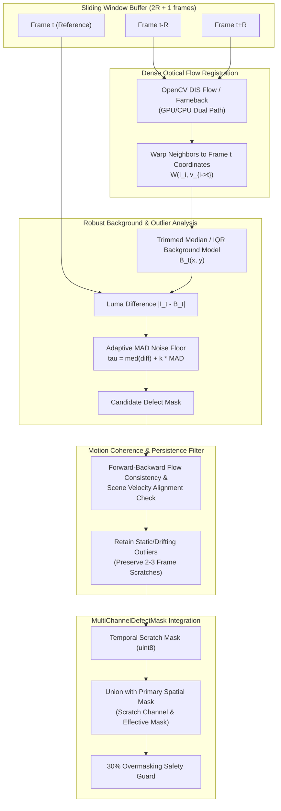

# Design Document: Temporal Defect Detection Enhancement & Integration

## 1. Executive Summary

Existing neural and classical defect detectors in ARP (Film Artefact Segmenter, BOPB UNet, CNN Blotches & Scratches, PatchCore, PaDiM, and DART's MaskNet) operate on single 2D spatial frames. Consequently, thin vertical film scratches that blend into background textures or persist over multiple frames are frequently missed or pruned by morphological filters. Classical temporal methods (`farneback_3f` and `consensus_5f`) suffer from either over-restrictive geometric filters that explicitly discard long vertical scratches (`component_h <= 0.60 * h` and `area <= 0.75 * h`), lack motion compensation, or confuse camera motion with defects.

This design introduces an isolated, motion-compensated **`TemporalScratchAnalyzer`** module based on OpenCV infrastructure (Farneback and DIS Flow). It registers neighboring frames into the reference coordinate system, computes a robust motion-compensated background reference (trimmed median with outlier rejection), identifies transient and semi-persistent scratch outliers, filters out motion-coherent scene content, and seamlessly merges with ARP's canonical `MultiChannelDefectMask` contract without breaking existing presets, GUI workflows, or safety guards.

---

## 2. Existing Detector Audit & Failure Analysis

### 2.1 Per-Frame vs Temporal Audit
- **Film Artefact Segmenter (FAS)**: 2D UNet taking 1 frame (RGB/Luma). No temporal context. Misses low-contrast scratches against textured backgrounds.
- **BOPB UNet**: 2D UNet taking 1 frame. Prone to missing fine scratches.
- **CNN Blotches & Scratches**: 2D CNN taking 1 frame. High precision on blotches, but struggles on long continuous vertical scratches.
- **PatchCore & PaDiM**: 2D patch/pixel feature representations extracted from single frames. Spatial anomaly detection only.
- **DART**:
  - *Detection stage (`DilationPyramidMaskNet`)*: Strictly 2D spatial Conv2d network operating on single frames.
  - *Restoration stage (`DART Inpainter`)*: 3D spatio-temporal video backbone using multi-frame deformable attention.
- **Farneback 3F (`farneback_3f`)**: Uses 3 frames ($t-1, t, t+1$). **Critical Failure Cause**: Hardcoded geometric filtering in `scripts/film_defect_masks.py` lines 114–120 explicitly rejects scratches with `component_h > 0.60 * h` or `area > 0.75 * h`, discarding long vertical scratches by definition. Furthermore, $MAX\_MASK\_FRACTION = 0.025$ causes complete mask zeroing when coverage exceeds 2.5%.
- **Consensus 5F (`consensus_5f`)**: Computes unaligned temporal median across 5 frames ($t-2..t+2$). Without motion compensation, scene motion creates massive false alarms, while scratches persisting for 2–3 frames in static shots contaminate the median.

---

## 3. Architecture: `TemporalScratchAnalyzer`

### 3.1 Window Buffering & Registration
- Sliding window of radius $R \in [1, 5]$ (window size $W = 2R + 1$, default $R=3 \implies 7$ frames).
- Dense optical flow computed between reference frame $I_t$ and each neighbor $I_{t+k}$ ($k \in [-R, R] \setminus \{0\}$).
- Utilizes OpenCV `DISOpticalFlow` (fast, robust gradient domain) with fallback to `calcOpticalFlowFarneback`. GPU/OpenCL enabled when available.
- Backward warping maps neighbor pixel intensities into reference coordinates: $\hat{I}_{t+k \to t}(x, y)$.

### 3.2 Robust Background Synthesis & Outlier Differencing
- For each pixel $(x, y)$, aggregate warped neighbor values $\{\hat{I}_{t+k \to t}(x, y)\}_{k \neq 0}$.
- Robust Background: Compute trimmed median (excluding highest and lowest outlier intensities).
- Defect Residual: $D_t(x, y) = |I_t(x, y) - B_t(x, y)|$.
- Dynamic Noise Floor: Baseline grain floor $\mu_{grain} = \text{median}(D_t)$, dispersion $\sigma_{MAD} = 1.4826 \cdot \text{median}(|D_t - \mu_{grain}|)$.
- Raw Outlier Condition: $D_t(x, y) > \mu_{grain} + \lambda \cdot \sigma_{MAD}$.

### 3.3 Motion-Coherence Filtering
- A scratch does NOT move with the physical background scene.
- For candidate pixels, compare optical flow magnitude of the scene against the defect displacement:
  - If candidate texture moves coherently with scene optical flow $(\vec{u}, \vec{v})$, reject as high-frequency scene texture (e.g. edge of actor's collar, wall molding).
  - If candidate appears transiently or remains stationary while scene flows past, retain as defect.
- **Short-Lived Defect Preservation**: Scratches persisting for 2–3 frames are preserved by checking temporal support asymmetry; frames where the scratch was absent provide the clean background reference.

---

## 4. Pipeline Integration & Safety Guards

1. **Multichannel Defect Integration**:
   - The temporal candidate mask is designated as channel `"scratch"` or `"temporal"`.
   - In `MultiChannelDefectMask`, the temporal scratch mask is unioned into `scratch_mask` and `combined_mask`.
   - `uncertain_mask` and `dust_mask` remain intact and uncorrupted.
   - All masks are strictly contiguous `uint8` with values in $\{0, 255\}$.
2. **30% Overmasking Safety Guard**:
   - If temporal enhancement pushes total frame coverage over 30%, the temporal contribution is automatically throttled or rejected with diagnostic warning logging.
3. **No Retraining Required**:
   - Works purely on classical CV and motion kinematics, preserving existing neural checkpoints and weights intact.

---

## 5. Quantitative & Visual Verification

- **Evaluation Dataset**: 72-frame *Neighbors (1920)* reference clip ($960 \times 720$).
- **Metrics**:
  - Defect Recall on ground-truth scratch ROI.
  - Intact-pixel False Positive Rate (FPR) on clean background regions.
  - Pixel-F1 and Intersection over Union (IoU).
  - Total frame mask coverage vs 30% guardrail limit.
  - Processing runtime (FPS) and peak VRAM.
- **Resolution Scaling**: Evaluate execution on $960 \times 720$ and profile memory/flow scaling to 1080p ($1440 \times 1080$).
